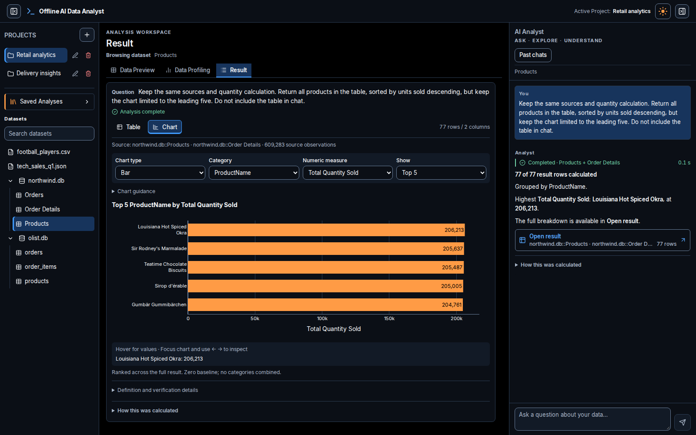
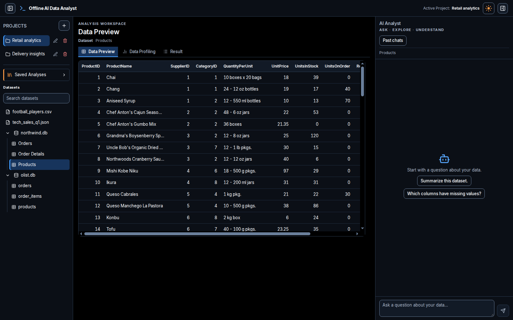
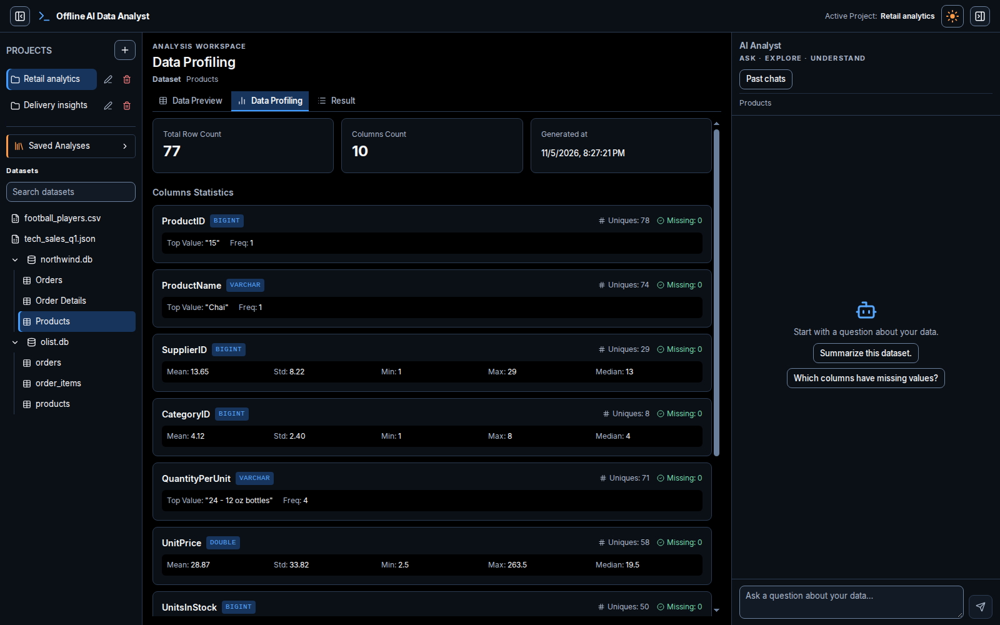
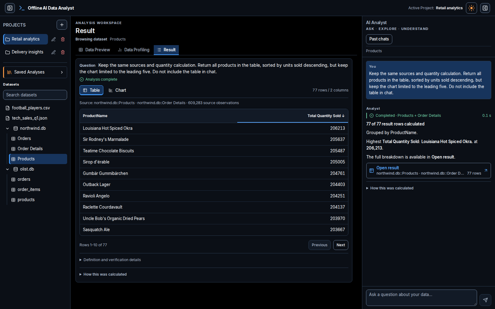
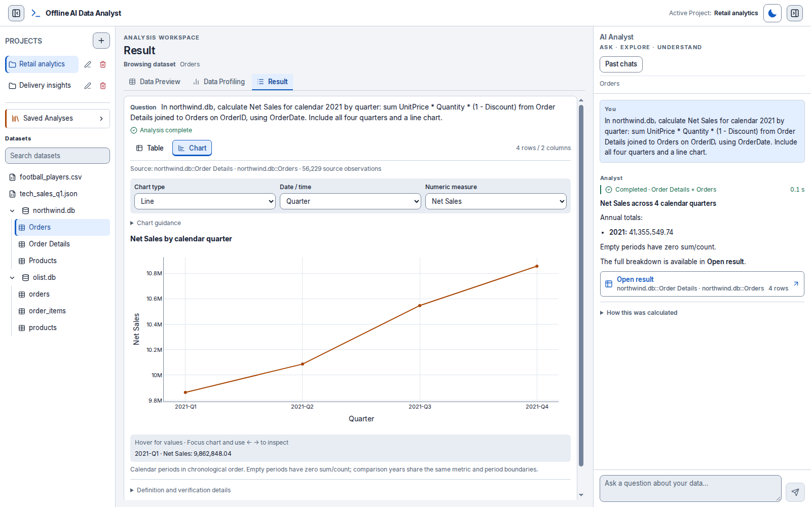
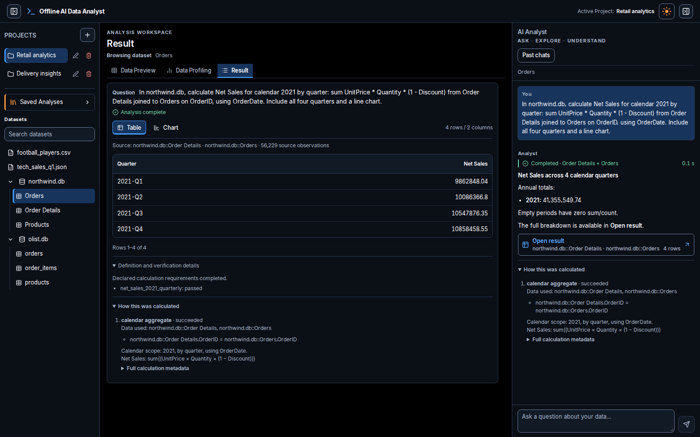
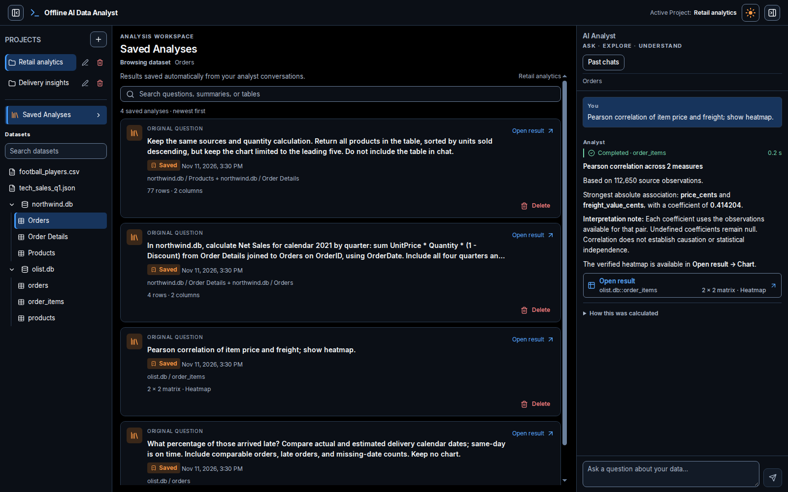
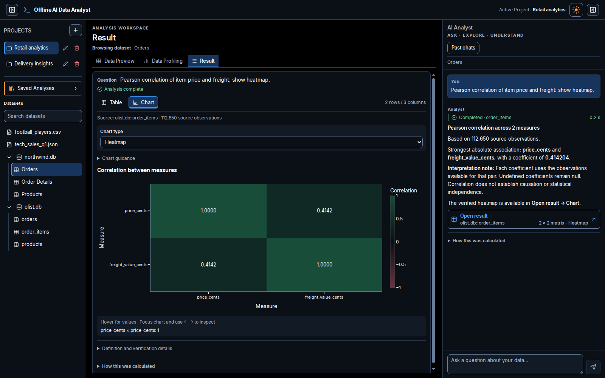
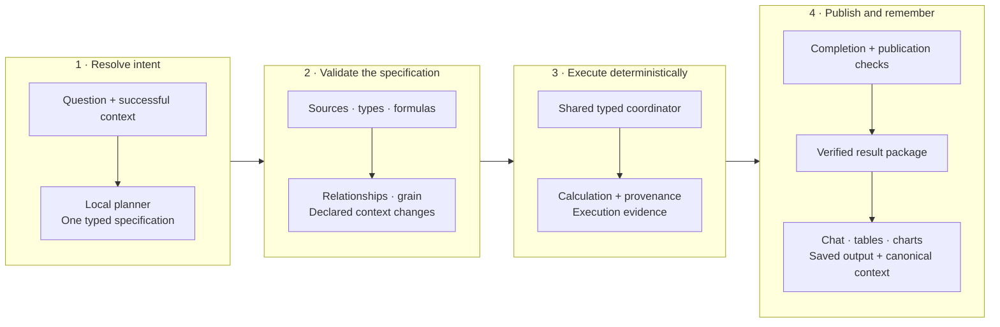

<div align="center">


# Offline AI Data Analyst

### Ask the question. Inspect the calculation.

A local analytics workspace that brings natural-language questions, inspectable calculations,<br />
interactive charts, and saved results into one place.

**Local inference · Typed analysis plans · Interactive Plotly · Persistent workspaces**

[See the workspace](#a-tour-of-the-workspace) · [Explore the engine](#how-an-answer-is-built) · [Run locally](#run-locally) · [Try a question](#questions-to-try) · [Understand the limits](#current-boundaries)

</div>



<p align="center"><em>One workspace: browse data on the left, inspect the result in the center, and follow the explanation on the right.</em></p>

**V1 is a local research and development application.** There is no hosted demo; the screenshots below provide a guided walkthrough, and the repository includes instructions for running it on your own machine. The committed inference path uses Ollama with Qwen 2.5 Coder 7B, without an API key.

## What makes it interesting

| Capability | What it means in practice |
| --- | --- |
| **An inspectable calculation behind the answer** | Supported requests become typed operations with explicit sources, filters, formulas, grouping, units, and output scope. |
| **Chat for findings, workspace for detail** | Small numerical answers stay in chat. Richer results open into tables and compatible charts, with calculation details available in both places. |
| **Charts bound to calculated results** | Result charts use the same structured table. A chart's Top N can show five products while the table retains all 77. |
| **Follow-ups with structured context** | Referenced successful specifications preserve unchanged fields. Declared changes are checked; standalone requests start from their own specification. |
| **Attention to analytical grain** | Supported staged comparisons average observations within an entity first, then give each contributing entity equal weight. |
| **Explicit missing-data semantics** | Date comparisons expose exclusions and denominators. A zero denominator stays undefined, rather than becoming a misleading 0%. |
| **Local persistence and inference** | Projects, conversations, calculation metadata, and saved outputs live locally. Plotly's renderer is bundled for offline use. |
| **A usable analysis desk** | Searchable catalog and saved results, resizable side panels, persisted light/dark themes, and keyboard chart inspection. |

## A tour of the workspace

### 1. Understand the data before asking

Select a catalog file or expand a SQLite database into its tables. **Data Preview** exposes the rows and columns; **Data Profiling** shows cached types, missing values, distinct-value estimates, and numeric or categorical summaries.

<table>
  <tr>
    <td width="50%"><a href="docs/images/data-preview.png"></a></td>
    <td width="50%"><a href="docs/images/data-profile.png"></a></td>
  </tr>
  <tr>
    <td align="center"><strong>Browse the source rows</strong></td>
    <td align="center"><strong>Inspect the column profiles</strong></td>
  </tr>
</table>

Click either image to inspect it at full size. V1 uses an operator-managed `datasets/` catalog; there is no upload form in the current UI.

### 2. Keep the full result without filling the chat

Chat presents findings and useful context. **Open result** exposes the detailed output package, including source tables, result dimensions, table pagination, and chart controls.

The example below retains **77 products** in the table. The opening screenshot charts only the leading five from that same result. Changing chart Top N does not change the calculation's table limit.



Small scalar answers do not need a redundant table, chart, or Open result entry. Explicit table requests are retained; a disabled chart preference hides chart controls for that result.

### 3. Explore trends in either theme

Calendar calculations support monthly, quarterly, and yearly periods, including supported year comparisons. Formulas and date columns belong to the calculation specification.

In this Northwind example:

```text
Net Sales = SUM(UnitPrice × Quantity × (1 − Discount))
Calendar: 2021 · Date: OrderDate · Grain: quarter
```

The annual total is **41,355,549.74 in the source currency units**. V1 does not infer a different currency from an unrelated earlier analysis.



Both themes cover navigation, inputs, tables, chat, and Plotly. Orange leads the categorical palette, blue provides a contrasting series, and keyboard controls expose chart values alongside hover inspection.

### 4. Open the calculation, not just the answer

**How this was calculated** exposes saved sources, joins, filters, formulas, and relevant exclusions. The workspace also keeps definition and verification details available in an expandable section.



For delivery comparisons, this includes calendar-date semantics, the matched/comparable denominator, and missing-date populations. For staged comparisons, it records entity-level averaging and equal entity weighting.

### 5. Return to an analysis later

**Saved Analyses** collects structured results from project conversations. Search by question, summary, or source; reopen a result with its table, compatible charts, and calculation metadata. **Past chats** provides the conversation history.



Saved results are snapshots. Reopening one displays its stored output; it does not silently rerun the model or refresh calculations against changed data.

<details>
<summary><strong>More of the workspace: correlation heatmaps</strong></summary>

Pearson and Spearman correlation are supported. The example below compares item price and freight, with the coefficient explained in chat and the matrix available as a heatmap. Undefined coefficients remain null; association is not presented as causation.



</details>

<details>
<summary><strong>About these screenshots</strong></summary>

Captured from the actual local React application in isolated Chrome at **1600 × 1000**, with a device scale factor of 1 and no application scaling. They replay existing verified result packages and read actual cached Northwind previews/profiles. The screenshot session made no live model calls and did not modify existing user projects or history.

Project names are demonstration labels. Response times shown during replay are not inference benchmarks. Some screenshots include the optional Olist catalog, which is not bundled with the repository.

</details>

## How an answer is built



Unclear or unsupported specifications return clarification or an explicit incomplete outcome. The shared deadline and cancellation/publication guards apply across the flow.

The model interprets the question; the supported deterministic route performs the arithmetic. A shared operation registry defines parameter ownership, output identities, and execution requirements. Planning has one existing bounded schema-repair opportunity within the shared request deadline.

**What verification establishes:** the declared, supported calculation was executed and its output satisfies the generated contract. It does **not** independently prove that arbitrary English was interpreted correctly. Semantic regressions are evaluated with expected specifications and independent SQLite answers.

Custom Python and conversation remain separate routes. Python execution has its own restrictions; plausible stdout or a captured chart alone does not establish a verified calculation.

### Supported deterministic work

| Operation family | Examples and boundaries |
| --- | --- |
| Counts and aggregates | Counts, distinct counts, sums, means, grouped measures, supported derived arithmetic, filtering, sorting, and explicit unit conversion. |
| Calendar analysis | Month/quarter/year aggregation, complete calendar periods, and supported year-over-year comparisons. |
| Column comparisons | Numeric or calendar-date comparisons, grouped rates, missing-value accounting, and percentage sorting. |
| Entity-first comparisons | Mean observations within a declared entity key, validate the relationship and grain, classify entities, then average entity means equally. This is a bounded operation, not arbitrary multi-stage workflows. |
| Descriptive statistics | Explicitly selected nonmissing count, mean, median, min/max, dispersion, quartiles, and supported IQR outlier outputs. |
| Correlation | Pearson or Spearman matrices with null handling and compatible heatmaps. |
| Filtering | Typed predicates over supported source columns. |

Result chart choices include compatible **bar, line, scatter, histogram, box, and heatmap** views. Availability depends on the result's structure and declared chart preference: required, automatic, or disabled.

## Run locally

### Docker Compose

Install Docker with Compose. The stack runs **Ollama**, **FastAPI**, and the **React/Vite** development UI.

```bash
git clone https://github.com/HITESH-235/offline-data-analyst-v1.git offline-data-analyst
cd offline-data-analyst
```

**Before starting:** edit the `ollama` volume in `docker-compose.yml`. Its current host path is specific to the development machine. Point it to your own model cache, for example:

```yaml
volumes:
  - ${HOME}/.ollama:/root/.ollama
```

Then start the services and download the model:

```bash
docker compose up -d --build
docker compose exec ollama ollama pull qwen2.5-coder:7b
```

| Service | Local address |
| --- | --- |
| Application | [localhost:3001](http://localhost:3001) |
| Interactive API documentation | [localhost:8001/docs](http://localhost:8001/docs) |
| API health | [localhost:8001/api/v1/health](http://localhost:8001/api/v1/health) |

If you use Docker Desktop on Linux, select its context first with `docker context use desktop-linux`. The Compose stack mounts the source for development reloads. GPU acceleration is hardware-specific and is not configured by the default Compose file.

```bash
# Inspect service logs
docker compose logs -f backend

# Stop services without deleting the workspace
docker compose down
```

The first setup needs internet access for images, packages, and model weights. Local inference can run offline afterward; prepare any required DuckDB extensions before disconnecting. Model loading and generation latency depend on available hardware.

<details>
<summary><strong>Manual development setup</strong></summary>

Use Python **3.11** and Node **20.19+ or 22.12+**. Install and start Ollama locally, then pull the configured model:

```bash
ollama pull qwen2.5-coder:7b
```

From the repository root, start the backend in one terminal:

```bash
cd server
python3 -m venv venv
source venv/bin/activate
pip install -r requirements.txt

export WORKSPACE_DIR="$(cd .. && pwd)/workspace"
export DATASETS_DIR="$(cd .. && pwd)/datasets"
export METADATA_DB_URL="sqlite:///$WORKSPACE_DIR/metadata.db"
export OLLAMA_BASE_URL="http://127.0.0.1:11434"
export OLLAMA_MODEL="qwen2.5-coder:7b"
mkdir -p "$WORKSPACE_DIR"

uvicorn main:app --host 127.0.0.1 --port 8000 --reload
```

In another terminal, from the repository root:

```bash
cd client
npm ci
VITE_API_URL=http://127.0.0.1:8000/api/v1 npm run dev
```

Open the Vite URL printed in the terminal, normally `http://localhost:5173`. The manual backend documentation is at `http://127.0.0.1:8000/docs`.

</details>

## Bring data into the catalog

Place supported files directly inside `datasets/`, then restart the backend to refresh the catalog and cached profiles. CSV, JSON, and SQLite are the main demonstrated paths. SQLite tables appear as `database.db::TableName`, and declared foreign keys inform supported joins.

The repository includes:

| Dataset | A useful starting point |
| --- | --- |
| `northwind.db` | Product rankings, declared table joins, and calendar Net Sales. |
| `football_players.csv` | Small grouped aggregates, statistics, and correlations. |
| `tech_sales_q1.json` | Browsing and analysis of a JSON dataset. |

Excel is accepted by the dataset loader, but the current profiler's XLSX path is incomplete; use CSV or SQLite for the documented walkthrough.

**Optional Olist example:** obtain the original source files separately, place them in `datasets/brazilian-ecommerce/`, and follow the [Olist import guide](docs/olist-import.md). The importer produces a local SQLite database with declared relationships and integer BRL cents. The raw files and imported Olist database are not bundled. Do not apply Northwind's discount formula to Olist payments.

## Questions to try

Create a project, select the relevant catalog source, and ask a specific question. These examples illustrate supported specifications; successful fresh language interpretation still depends on the model.

**A simple scalar — Northwind Products**

> Count all rows in northwind.db::Products. No chart.

**A ranking with independent table and chart scope — Northwind**

> Join Products and Order Details on ProductID. Sum Quantity by ProductName. Return all products sorted by total quantity descending. Chart only the leading five. Do not include the table in chat.

**A compound formula and time series — Northwind**

> For calendar 2021, calculate monthly Net Sales using OrderDate. Join Orders and Order Details on OrderID. Net Sales = SUM(UnitPrice × Quantity × (1 − Discount)). Return all twelve months chronologically and draw a line chart. Keep the original currency units; do not inherit previous filters.

**A focused statistical request — football players**

> For age and player_rating, report nonmissing count, mean, median, minimum and maximum. Show a table. No chart.

**A structured follow-up — after the Net Sales result**

> Keep the same source, year and Net Sales formula, but group by quarter instead of month. Keep the line chart.

<details>
<summary><strong>A staged comparison — requires the optional Olist import</strong></summary>

> For delivered orders purchased during 2018, compare average review scores for late versus on-time deliveries. Compare actual and estimated calendar dates, treating same-day delivery as on time. Average reviews within each order_id first, then weight every order equally. Report exclusions for missing dates or reviews.

This tests a meaningful distinction: averaging every review row can overweight orders with repeated reviews. The supported staged operation computes each order's review mean first, then averages contributing orders equally, with explicit date and review exclusions.

</details>

## Stack and source map

| Layer | Implementation |
| --- | --- |
| Interface | React 19, Vite, Lucide icons, Markdown rendering, CSS theme tokens. |
| API and persistence | FastAPI, Pydantic typed contracts, SQLAlchemy, SQLite. |
| Analysis | Pandas, NumPy, DuckDB profiling, reusable deterministic operations. |
| Inference | Ollama; default model `qwen2.5-coder:7b`. |
| Charts | Bundled Plotly.js for result views; Python chart/artifact support. |
| Additional execution | AST-checked, resource-bounded Python subprocesses. |
| Reporting API | Markdown/PDF report generation; not a report-building screen in the current UI. |

```text
client/
  src/components/          Chat, catalog, results, saved analyses
  src/context/             Project state, requests, history restoration
  src/theme/               Persisted themes and chart palettes
  public/vendor/           Local Plotly renderer
server/
  app/analysis/            Shared operation contracts and calculations
  app/services/            Coordinator, context, result packages, presentation
  app/llm/                 Planner and local inference client
  app/sandbox/             Python validation and subprocess execution
  tests/                   Replays, analytical regressions, contract checks
datasets/                  Catalog inputs
workspace/                 Local runtime state and generated outputs (ignored)
docs/                      Technical notes and this README's screenshots
```

For the main boundaries, start with [typed operations](server/app/analysis/operations.py), the [deterministic coordinator](server/app/services/planned_analysis.py), [result publication](server/app/services/analysis_package.py), and [structured follow-up validation](server/app/services/specification_context.py).

## Checks and verification

The [implementation handoff](docs/implementation-handoff-2026-11-11.md) records the **November 11, 2026** verification snapshot:

| Check | Recorded result |
| --- | --- |
| Full backend regression suite | 269 tests passed. |
| Frontend checks | 73 tests passed. |
| Browser replay | 38 checks passed using the real app and intercepted verified responses. |
| Frontend production build | Passed. |

These are dated results from the prepared development workspace, not a universal model success rate. Independent SQLite comparisons cover selected financial, date-comparison, counting, and staged-aggregation cases. Browser replay and constructed planner fixtures do not prove fresh live model interpretation.

With the Compose stack running:

```bash
# Backend suite
docker compose exec -e PYTHONPATH=/app/server -w /app/server \
  backend python -m unittest discover -s tests -v

# Frontend checks and production build
docker compose exec frontend npm test
docker compose exec frontend npm run build
```

Some backend integration/replay tests depend on the optional Olist import and local evaluation captures. A fresh clone does not include those datasets or complete evaluation directories; it cannot reproduce every workspace-dependent test without preparing those inputs.

## Current boundaries

- **Local development, not public hosting.** The default stack uses development servers, local storage, permissive CORS, and no application authentication. Public deployment needs separate hardening and infrastructure work.
- **Bounded analytics.** Unsupported operations, invalid relationships, ambiguous references, and unsupported compositions can clarify or fail. Cross-database joins are not supported. Adding or removing outputs within an existing follow-up remains unsupported.
- **A model can misunderstand.** Typed validation checks structure, declared changes, and executable semantics. It cannot guarantee that the specification matches every detail of a natural-language request. Inspect the resolved calculation for important decisions.
- **Memory-bound execution.** Analysis loads source data into Pandas; this is not an out-of-core or distributed analytics engine. Large datasets and joins require sufficient RAM. No general maximum dataset size is claimed.
- **Bounded time, variable latency.** The shared request deadline defaults to 120 seconds, with cancellation and late-publication guards. A valid request may still time out on slow inference. Phase timings and reported token counts aid diagnosis; missing usage remains unknown.
- **Snapshots are not versioned datasets.** Saved outputs persist, but source files are not an immutable data-versioning system. Reopening is not rerunning; changed datasets can change future calculations. Some historical records lack the typed identity needed for follow-ups and require a new standalone request.
- **Python isolation has limits.** Generated code is AST-checked and executed in a subprocess with a 10-second timeout and an attempted 2 GiB address-space limit on supported Unix systems. This is not a dedicated container or hardened security boundary for hostile code.
- **Offline operation needs preparation.** Images, dependencies, model weights, and relevant extensions must already be available. The committed local inference path needs no hosted API, and the result-chart renderer needs no CDN.

---

<div align="center">

**Explore the data. Read the answer. Open the calculation.**

[Back to the workspace ↑](#offline-ai-data-analyst)

</div>
